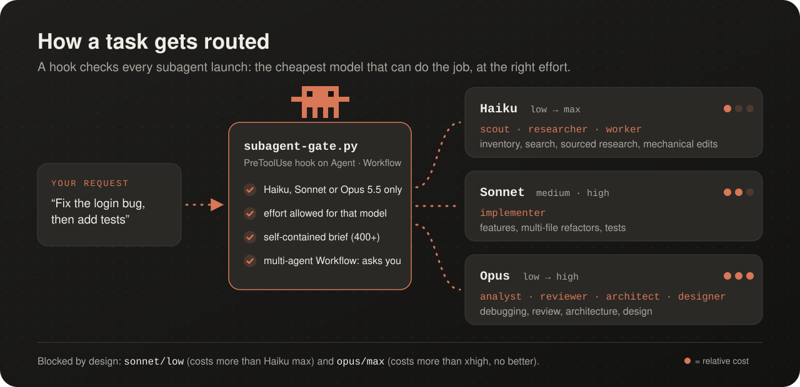
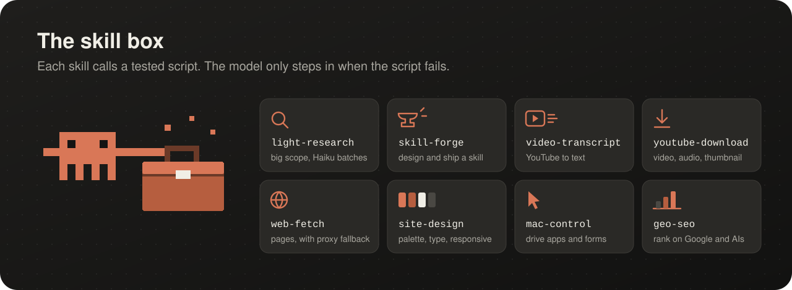

<p align="center">
  
</p>

<p align="center">
  <a href="#install"><b>Install</b></a> ·
  <a href="#how-it-works"><b>How it works</b></a> ·
  <a href="#whats-inside"><b>What's inside</b></a> ·
  <a href="#skills"><b>Skills</b></a>
</p>

## What is this?

My personal Claude Code setup, versioned and installed on every machine I work on. It is public because
some of you will want to borrow parts of it, and you should: each piece works on its own.

It is built around three goals:

- **Spend as few tokens as possible.** Each task goes to the cheapest model that can do it, at the right
  effort. Scripts do the mechanical work for zero model tokens. Large scopes are read in cheap Haiku batches.
- **Never trade reliability for it.** Every subagent gets a self-contained brief with acceptance criteria.
  Reviews and hard calls go to Opus. Every skill script has unit tests. When something fails, the rule is:
  improve the brief first, then raise the effort, and only then switch to a bigger model.
- **Keep a box of reusable skills.** Agent skills for Claude Code: transcripts, downloads, blocked web pages, site design audits, SEO for
  AI assistants, Mac automation, publish-ready repositories. Take one, take them all.

> [!TIP]
> Everything is written in English, and Claude still answers in your language. To force it, add one line to
> your own `~/.claude/CLAUDE.md`, for example: `Always reply to the user in French.`

## How it works

<p align="center"></p>

- **`subagent-gate.py`** is a `PreToolUse` hook. Before any subagent starts, it checks the model, the effort,
  and the length of the brief. Multi-agent workflows ask you first, unless you set
  `SUBAGENT_GATE_WORKFLOW=allow`.
- **`CLAUDE.md`** holds the rules: which agent for which task, a 7-part brief template, and a reflex to ask
  *"light Haiku research?"* before scanning a large, vague scope.
- **Skills are scripts first.** The model launches them, reads the result, and only edits the script if it
  breaks.

<p align="center"></p>

## What's inside

| Path | What it is |
|---|---|
| `kit/CLAUDE.md` | Global rules: model × effort matrix, agent choice, brief template, git hygiene |
| `kit/agents/` | 10 subagents, each pinned to a model and an effort (table below) |
| `kit/hooks/subagent-gate.py` | The routing hook that enforces the matrix |
| `kit/settings.snippet.json` | Model pins, hook registration, no AI attribution in commits |
| `skills/` | 10 skills, each with a tested script |
| `lib/` | Helpers shared by skills (local settings, proxy fallback) |
| `tools/` | Pre-commit checks and a one-command skill publisher |

| Agent | Model · effort | Used for |
|---|---|---|
| `scout` | Haiku · low | inventories, grep, extracting facts |
| `researcher` | Haiku · medium | web and GitHub research with sources |
| `worker` | Haiku · high | fully specified edits, small fixes, simple scripts |
| `implementer` | Sonnet · high | features, multi-file refactors, tests |
| `fixer` | Opus · low | well-specified but delicate execution |
| `analyst` | Opus · medium | debugging, comparing approaches |
| `visual-qa` | Opus · medium | screenshots, layout, mobile rendering |
| `reviewer` | Opus · high | independent review, security, regressions |
| `architect` | Opus · high | cross-system decisions, stubborn bugs |
| `designer` | Opus · high | UI, visuals, creative work |

## Skills

<p align="center"></p>

| Skill | What it does | Needs | claude.ai |
|---|---|---|---|
| [`light-research`](skills/light-research) | Splits a large scope into ~25k-token batches for Haiku subagents | nothing | no (subagents) |
| [`skill-forge`](skills/skill-forge) | Decides if a request deserves a skill, then designs, tests and publishes it | git | no |
| [`video-transcript`](skills/video-transcript) | YouTube transcript from subtitles, or audio + local Whisper | yt-dlp, ffmpeg, faster-whisper | no |
| [`media-download`](skills/media-download) | Video, or audio only as MP3, from YouTube, Instagram, TikTok and INA links (batches, metadata) | yt-dlp, ffmpeg | no |
| [`web-fetch`](skills/web-fetch) | Fetches a page when direct access is blocked (403, 429), with proxy fallback | nothing | no |
| [`site-design`](skills/site-design) | Palette, fonts, spacing, CSS variables and responsive screenshots of a site | Playwright | no |
| [`mac-control`](skills/mac-control) | Drives Mac apps and forms with safety rails | cua-driver, macOS | no |
| [`geo-seo`](skills/geo-seo) | Gets a site recommended by Google and AI assistants: audit, plan, fixes, measurement | Python | partly (audit scripts need network) |
| [`repo-showcase`](skills/repo-showcase) | Makes a repository publish-ready: interview, audit of secrets and personal data (history included), AI-mention cleanup, structure review, custom animated visuals, screenshots, live counters | git, gh; Playwright and git-filter-repo for some steps | no |
| [`promo-codes`](skills/promo-codes) | Finds publicly shared promo codes for a merchant and ranks them best first (listed, never tested) | yt-dlp (optional) | no |

## Install

### Option A: let Claude Code do it

Paste this into Claude Code:

```text
Install https://github.com/titouannwtt/claude-tools for me.
1. Clone it to ~/claude-tools (or pull if it already exists) and run ./install.sh.
2. Show me what kit/install_kit.sh would change in ~/.claude, then run it once I agree.
   Never overwrite my existing CLAUDE.md: show me a diff and merge only the sections I pick.
3. Merge kit/settings.snippet.json into ~/.claude/settings.json without removing my existing keys or hooks.
4. Ask me which language Claude should reply in, and add that rule to my ~/.claude/CLAUDE.md.
5. List the skills now available and the dependencies still missing (yt-dlp, ffmpeg, Playwright...).
```

### Option B: by hand

```bash
git clone https://github.com/titouannwtt/claude-tools.git ~/claude-tools
cd ~/claude-tools
./install.sh          # symlinks every skill into ~/.claude/skills and installs the git hooks
kit/install_kit.sh    # agents + routing hook; backs up what it replaces, never overwrites CLAUDE.md
```

Then merge `kit/settings.snippet.json` into `~/.claude/settings.json`, and copy `local.env.example` to
`local.env` if you want the proxy fallback or the pre-commit name filter.

**Just one skill?** Link it instead of copying it, because some skills import `lib/`:

```bash
ln -s ~/claude-tools/skills/web-fetch ~/.claude/skills/web-fetch
```

**Just the routing?** Copy `kit/agents/*.md` to `~/.claude/agents/` and `kit/hooks/subagent-gate.py` to
`~/.claude/hooks/`, then add the hook block from `kit/settings.snippet.json`.

### Option C: Claude in the browser (claude.ai)

Agents, hooks and settings are Claude Code features, so on claude.ai you get the skills that run without
local tools, and the rules as preferences.

1. **Skills.** Turn on *Code execution and file creation* in Settings. Zip a skill folder
   (`cd skills && zip -r geo-seo.zip geo-seo`), then upload it in *Customize → Skills*
   (older menus: *Settings → Capabilities → Skills*). [Anthropic help page](https://support.claude.com/en/articles/12512180-using-skills-in-claude).
2. **Rules.** Send this to Claude, then paste its answer into your personal preferences or a Project's
   instructions:

```text
Read https://raw.githubusercontent.com/titouannwtt/claude-tools/main/kit/CLAUDE.md.
Rewrite it in English as personal preferences for claude.ai, under 1,500 characters.
Drop everything specific to Claude Code (subagents, hooks, settings, slash commands, workflows).
Keep the cost-aware habits, the "ask before a large vague task" rule, the reliability rules and the style rules.
```

## Safe to publish by design

- `local.env` (ignored by git) holds everything private: proxy URL, second machine, forbidden terms.
- The **pre-commit** hook blocks secrets, IP addresses, personal paths, credentials in URLs, terms from
  `FORBIDDEN_TERMS`, and any git e-mail that is not a `noreply` address.
- The **commit-msg** hook rejects AI attribution lines (`Co-Authored-By: Claude`, "Generated with...").
- `tools/publish_skill.sh <name>` runs the checks, commits, pushes and syncs a second machine.

Run all tests: `for d in tools skills/*/; do [ -d "$d/tests" ] && (cd "$d" && python3 -m unittest discover -s tests -q); done`

## License

[MIT](LICENSE): copy, adapt and reuse any part, just keep the copyright notice.

---

<sub>Not affiliated with Anthropic. Claude and its mascot are Anthropic's; the pixel mascot in these images is a
fan illustration.</sub>
